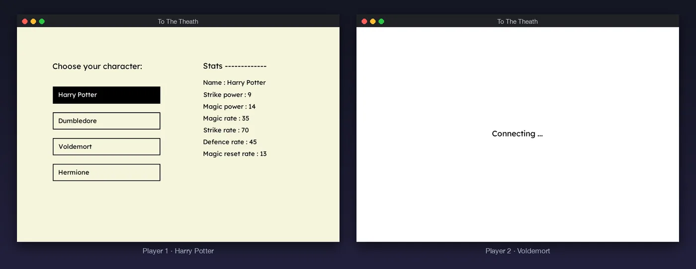
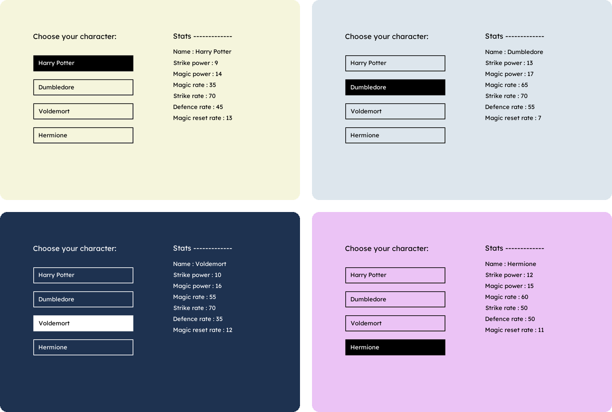

<div align="center">

# To The Theath

**A two-player wizard duel over the network, built with Pygame and raw sockets.**<br>
Advanced Programming final project &nbsp;·&nbsp; University of Isfahan &nbsp;·&nbsp; Spring 2023

<br>



<sub>A real match: the server and two clients on one machine, trimmed from 14 rounds.</sub>

</div>

<br>

Two players connect to a server, each picks a wizard, and they duel in rounds. Every round both choose to **strike**, cast **magic** or **defend**, and the server settles the round with each character's odds. Health and magic bars update on both screens, and the first to drop to zero loses.

## The characters



Each wizard trades power for reliability. Dumbledore hits hardest and casts most reliably; Voldemort's magic is strong but his defence is weak; Harry's spells often miss, but his magic recovers fastest. Picking a character also switches the window to that character's theme.

## How a round works

- **Strike** and **magic** land with the character's success rate. Magic hits harder but costs magic points; once a player runs low, the magic option is disabled.
- **Defence** can block an attack. Blocking a spell also drains the caster's magic and restores the defender's.
- If both players reach zero in the same round, the server picks the winner at random.

## Under the hood

The server is a plain TCP server on port 4000, with one thread per connected player. Players who press start wait in a queue until a second one arrives, then the two are paired into a match. Every message is a small JSON object with a `header`:

| Direction | Header | Carries |
| :-- | :-- | :-- |
| server → client | *(on connect)* | the four characters and their stats |
| client → server | `start_game` | the chosen character |
| server → both | `namechosed` | the opponent, once the match starts |
| client → server | `move` | `strike`, `defence` or `magic` |
| server → both | `change_stat` | health and magic for both sides, and what happened |
| server → both | `end` | `win`, `lose`, or `enemy_disconnected` |

The server waits for both moves before resolving a round, keeps the game rules in pydantic models, and writes every match, round by round, to `server/ttt_log.txt`. If a player drops out, the other is told and can start a new game. The client is a single Pygame loop that draws whichever scene is current, with a background thread listening to the socket.

## Running it

You'll need Python 3.10 or 3.11 (the pinned pydantic 1.10 predates 3.12).

```bash
pip install -r requirements.txt
python server/server.py        # from the repository root
python game/main.py            # in two more terminals, one per player
```

Use <kbd>↑</kbd> <kbd>↓</kbd> to move through the options and <kbd>Enter</kbd> to choose. The client connects to `127.0.0.1:4000`; to play across a network, change `server_address` in `game/main.py`.

## Layout

```
game/      the Pygame client: scenes, UI helpers and the Lexend font
server/    the socket server, matchmaking, the fight rules and the match log
Report/    the project report, in Persian (PDF and Word)
```

## Credits

Built by

- Mohammad Mallaee &nbsp;[@mohammad-mallaee](https://github.com/mohammad-mallaee)
- Davoud Nosrati Amirabadi &nbsp;[@ausdavoud](https://github.com/ausdavoud)

for Dr. Fatemeh Mansouri's Advanced Programming course at the Faculty of Mathematics and Statistics, University of Isfahan. Released under the [MIT License](LICENSE).
